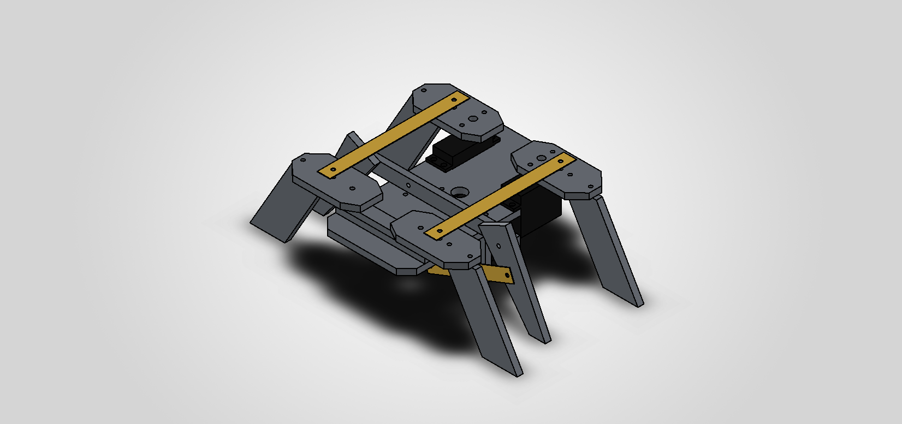

# Hexapod_Mechatronics: Hex3Bot, a 3-servo hexapod

A six-legged walking robot driven by **only three servos**, modelled in SolidWorks 2026, with an interactive 3D demo you can play in your browser.



The design follows the "Hex3Bot" build from *Robot Builder's Bonanza* (Gordon McComb): a 7" × 3.5" body cut from 6 mm expanded PVC, brass-strip linkages, and three standard R/C servos.

---

## ▶ Play the demo

The demo shows the robot walking with its tripod gait, using the real geometry of the SolidWorks parts.

### Option 1: Online (nothing to install)

Open this link:

**https://raw.githack.com/nour-issa/Hexapod_Mechatronics/main/CAD/demo/Hex3Bot_Demo.html**

### Option 2: On your computer

1. Click the green **Code** button on this page and choose **Download ZIP** (or `git clone https://github.com/nour-issa/Hexapod_Mechatronics.git`).
2. Unzip it.
3. Open the folder `CAD/demo` and **double-click `Hex3Bot_Demo.html`**. It opens in your web browser.

You need an internet connection the first time, because the page loads the three.js 3D library from a CDN. All the robot geometry is already inside the HTML file.

If the page stays blank, your browser is blocking local files. Serve the folder instead (needs Python):

```bash
cd Hexapod_Mechatronics
python -m http.server 8765 --directory CAD/demo
```

Then open http://localhost:8765/Hex3Bot_Demo.html.

### How to use the demo

| Control | What it does |
|---|---|
| **Play / Pause / Next step** | Run the gait automatically, or step through it one move at a time. The panel explains each step. |
| **3D / Front / Side / Top** | Camera views. **Front** shows the side-to-side rocking best. Drag to orbit, scroll to zoom. |
| **Orange / grey dots** | Feet on the ground / feet in the air. Watch the three-foot tripod switch sides. |
| **Real ground contact** | On: the body tilts onto its lowest feet and walks forward. Off: the body stays still (like in SolidWorks). |
| **Servo sliders** | Drive each of the three servos yourself. |
| **Speed** | Slow it down to follow the motion. |

---

## How the mechanism works

The trick is that **the legs are linked together**, so one servo moves several legs at once. At least three feet are always on the ground (a tripod), so the robot never has to balance.

### 1. Front + rear legs on each side: parallelogram linkage (2 servos)
- The **rear leg** is mounted on a servo horn and turns about a vertical axis.
- The **front leg** pivots freely on a screw through the base.
- A **long brass strip** joins the two legs. The holes are spaced so that the legs, the strip and the base form a **parallelogram four-bar linkage**: the front leg copies the rear leg's angle exactly.
- So each side servo sweeps two legs forward or backward together.

### 2. Middle legs: rocker that tilts the body (1 servo)
- Each middle leg hangs from a pivot at the end of the **middle spar** and swings sideways.
- The middle servo sits under the base with a **round horn**. Two **short brass strips** run from holes at 5 and 7 o'clock on the horn to the middle legs: two **four-bar linkages** with one shared input.
- Turning the horn pushes one middle leg down and pulls the other up, so the robot **rolls from side to side**. On the low side, the front and rear feet stay on the ground; on the high side, they lift off (about 7.6 mm in this model).

### 3. The walking gait (3 steps, repeated)
1. **Rock:** the middle servo lowers one middle leg. The opposite side's front and rear feet stay down, and the same side's lift.
2. **Power stroke:** the servo for the side that is *on the ground* sweeps its legs **backward**. The feet push on the floor, and the robot moves forward (about 35 mm per stroke here).
3. **Return stroke:** the servo for the side that is *in the air* swings its legs **forward**, ready for the next push.

Then rock the other way and repeat with the sides swapped.
- **Reverse:** push the legs forward instead of backward.
- **Turn:** only one side does power strokes.

---

## Open the CAD model

**Requires SolidWorks 2026 or newer** (SolidWorks files can't be opened by older versions).

1. Download or clone the repo.
2. Open `CAD/Hex3Bot_Assembly.SLDASM`.
3. **Drag a rear upper leg** (the plate on top of a side servo): the front leg on that side follows it through the brass link.
4. **Drag the white round horn** under the body: the two middle legs rock up and down.

The assembly has 35 mates:
- `Pin_...` mates are the pivot joints (axis + plane).
- `Lock_...` mates hold parts that are screwed together.
- `Limit_...` mates set each servo's travel: ±30° for the leg servos and ±60° for the middle servo. Edit them in the MateGroup to change the range.

In the model the body is fixed, so you see the legs move relative to the body. On the real robot, the lowered middle leg lifts and tilts the body instead (the browser demo shows this).

### Parts

| File | Part | Qty |
|---|---|---|
| `Base.SLDPRT` | Body plate, 7" × 3.5" | 1 |
| `Middle_Spar.SLDPRT` | Spar that carries the middle-leg pivots | 1 |
| `Front_Leg_Spacer_Spar.SLDPRT` | Spacers under the front legs | 2 |
| `Middle_Servo_Mount.SLDPRT` | Holds the middle servo under the base | 1 |
| `Leg_Upper_Rear.SLDPRT` | Rear upper leg (mounts on the servo horn) | 2 |
| `Leg_Upper_Front.SLDPRT` | Front upper leg (pivots on a screw) | 2 |
| `Leg_Lower_FrontRear.SLDPRT` | Lower leg, feet cut at 30° | 4 |
| `Leg_Middle.SLDPRT` | Middle leg | 2 |
| `Link_Long_Brass.SLDPRT` | Front/rear leg link, 5-1/2" brass strip | 2 |
| `Link_Short_Brass.SLDPRT` | Middle leg link, 3-5/8" brass strip | 2 |
| `Servo_Standard.SLDPRT` | Generic standard-size servo | 3 |
| `Servo_StarHorn.SLDPRT` | Six-arm servo horn | 2 |
| `Servo_RoundHorn.SLDPRT` | Large round servo horn | 1 |

Simplifications: screws, nuts, spacers and L-brackets are not modelled, and the servo is a generic block. Where the book's drawings were unclear, dimensions were chosen so all six feet touch the ground in neutral and the linkages close exactly.

---

## Repository layout

```
CAD/
  *.SLDPRT, Hex3Bot_Assembly.SLDASM   SolidWorks 2026 parts and assembly
  renders/                            Images of the assembly
  demo/Hex3Bot_Demo.html              Interactive 3D demo (self-contained)
  demo/stl/                           Part geometry exported from the assembly
  src/                                Programs that generate everything
```

## Rebuilding from the source (optional)

Everything in `CAD/` was generated by C# programs that drive the SolidWorks API. You only need this if you want to change the design.

Requirements: Windows, SolidWorks 2026 (running), and the .NET Framework C# compiler that ships with Windows.

| Program | What it does |
|---|---|
| `src/Hex3Bot.cs` | Builds all parts and the assembly. Dimensions are constants at the top. |
| `src/Mates.cs` | Adds reference axes/planes (`refs`), mates (`mates`), drives the servos (`test`), or returns to neutral (`reset`). |
| `src/Check.cs` | Runs interference detection and saves the renders. |
| `src/Export.cs` | Exports each component to STL for the web demo. |
| `src/Demo.cs` | Animates the gait live inside SolidWorks (`live`). |
| `src/build_demo.py` + `src/demo3d_template.html` | Packs the STL files into `demo/Hex3Bot_Demo.html`. |

Compile a program (PowerShell, from the `CAD` folder), for example `Hex3Bot.cs`:

```powershell
$api = "C:\Program Files\SOLIDWORKS Corp\SOLIDWORKS\api\redist"
& C:\Windows\Microsoft.NET\Framework64\v4.0.30319\csc.exe /nologo /platform:x64 /out:Hex3Bot.exe /r:"$api\SolidWorks.Interop.sldworks.dll" /r:"$api\SolidWorks.Interop.swconst.dll" src\Hex3Bot.cs
Copy-Item "$api\SolidWorks.Interop.sldworks.dll","$api\SolidWorks.Interop.swconst.dll" .
.\Hex3Bot.exe "$PWD"
```

The template paths in `Hex3Bot.cs` point to `C:\ProgramData\SOLIDWORKS\SOLIDWORKS 2026\templates`. Change them if your SolidWorks templates are somewhere else.

Order for a full rebuild: `Hex3Bot.exe` → `Mates.exe <CAD folder> refs` → `Mates.exe <CAD folder> mates` → `Export.exe <CAD folder>` → `python src/build_demo.py <CAD folder>`.

## Credits

Mechanism and gait based on the Hex3Bot project in *Robot Builder's Bonanza* by Gordon McComb. CAD model, linkage kinematics and demo by Nour Issa.
